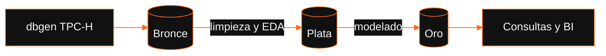
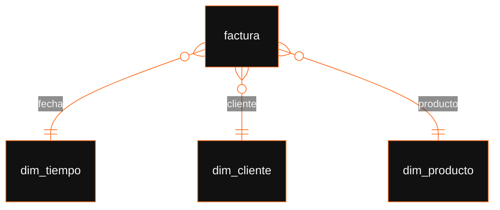

<div align="center">


<br>


**Data warehouse sobre TPC-H con capas Bronce, Plata y Oro.**

[Arquitectura](#arquitectura) &nbsp;·&nbsp; [Modelo](#modelo-dimensional) &nbsp;·&nbsp; [Ejecución](#ejecución) &nbsp;·&nbsp; [Estructura](#estructura)

</div>

<br>

## Resumen

Pipeline que genera datos con `dbgen` de TPC-H, los carga y los transforma
por capas hasta un esquema en estrella listo para análisis.

| Capa | Propósito |
|:--|:--|
| **Bronce** | Datos crudos tal como los genera `dbgen` |
| **Plata** | Limpieza: duplicados, espacios sobrantes, inconsistencias y `dwh_created_date` |
| **Oro** | Modelo dimensional para consumo analítico |

<br>

## Arquitectura



<br>

## Modelo dimensional



- **Tabla de hechos:** `factura`, construida a partir de `lineitem`.
- **Llaves:** sustitutas (`_pk`) y de negocio (`numero_orden`, `numero_linea`).
- **Grano:** una fila por línea de pedido; incluye líneas devueltas y no devueltas.
- **Periodo:** órdenes con fecha entre 1992-01-01 y 1997-12-31.

<br>

## Ejecución

```bash
git clone https://github.com/CaletOrtiz/sql-datawarehouse-project.git
cd sql-datawarehouse-project

# Ejecutar el pipeline en Docker (factor TPC-H por defecto: 0.01)
docker build -t sql-datawarehouse .
docker run --rm \
  -e TPCH_SCALE_FACTOR=0.01 \
  -v "$PWD/data:/app/data" \
  -v "$PWD/sources/tbl:/app/sources/tbl" \
  sql-datawarehouse
```

> [!NOTE]
> El workflow de GitHub Actions repite este proceso en cada push, pull request
> o ejecución manual. Al terminar correctamente, descarga `data/dwh.duckdb`
> desde la sección **Actions → Build data warehouse → Artifacts**. El artefacto
> se conserva durante 14 días. En CI se usa un factor de escala 0.01 para
> mantener una ejecución ligera; se puede cambiar en `.github/workflows/data-warehouse.yml`.

<br>

## 🛠️ Estructura del Repositorio

```text
├── data/              # Base DuckDB generada; ignorada en Git
├── docs/              # Documentación técnica: arquitectura, ERD por capa, proceso ETL
├── .github/workflows/ # Construcción Docker, ETL, validación y publicación del artefacto
├── Dockerfile         # Imagen reproducible del pipeline
├── scripts/           # SQL de las capas bronce, plata y oro
│   ├── bronce/        # DDL + carga de fuentes .tbl
│   ├── plata/         # Checks de calidad + DDL + ETL bronce→plata
│   └── oro/           # DDL estrella + ETL plata→oro
├── etl/               # Mapeo y scripts del proceso ETL / Limpieza
├── dashboard/         # Capturas de pantalla, reportes y archivos del Dashboard
├── .gitignore         # Configuración para ignorar archivos de datos pesados
└── README.md          # Descripción general del proyecto
```
<br>

---

<div align="center"><sub>Hecho por <a href="https://github.com/CaletOrtiz">Calet Ortiz</a></sub></div>
