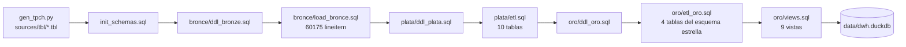
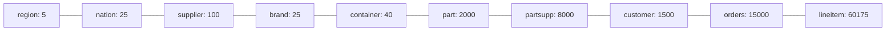

# Validación del Proceso ETL (ejecución real)

Proceso ejecutado con éxito sobre datos TPC-H de prueba (SF=0.01) el 5/10/2026
usando DuckDB 1.5.6 y los scripts del repositorio.

## Pipeline validado



## Volúmenes cargados



| Capa | Tabla | Filas |
|---|---|---|
| bronce/plata | tbl_region | 5 |
| | tbl_nation | 25 |
| | tbl_supplier | 100 |
| | tbl_brand | 25 |
| | tbl_container | 40 |
| | tbl_part | 2000 |
| | tbl_partsupp | 8000 |
| | tbl_customer / dim_cliente | 1500 |
| | tbl_orders | 15000 |
| | tbl_lineitem | 60175 |
| oro | factura | Líneas (devueltas y no devueltas) de pedidos con fecha entre 1992-01-01 y 1997-12-31 |
| | dim_tiempo | 2192 (1992-01-01 → 1997-12-31) |

## Consultas de ejemplo sobre ORO

```sql
-- 1. Revenue por año y quarter
SELECT d.anio, d.trimestre,
       ROUND(SUM(f.venta_neta), 2) AS venta_neta
FROM oro.factura f
JOIN oro.dim_tiempo d ON f.fecha_venta = d.tiempo_pk
GROUP BY 1, 2 ORDER BY 1, 2;

-- 2. Top 10 clientes por venta neta
SELECT c.nombre_cliente, c.pais_nombre,
       ROUND(SUM(f.venta_neta), 2) AS venta_neta
FROM oro.factura f
JOIN oro.dim_cliente c ON f.cliente_fk = c.cliente_pk
GROUP BY 1, 2 ORDER BY venta_neta DESC LIMIT 10;

-- 3. Venta neta por marca
SELECT p.marca, ROUND(SUM(f.venta_neta), 2) AS venta_neta
FROM oro.factura f
JOIN oro.dim_producto p ON f.producto_fk = p.producto_pk
GROUP BY 1 ORDER BY venta_neta DESC;

-- 4. KPIs ejecutivos por año
SELECT anio, total_facturas, clientes_activos, venta_neta,
       crecimiento_interanual_pct
FROM oro.vw_rfv12_kpis_ejecutivo
ORDER BY anio;
```

## Buenas prácticas de ejecución

```mermaid
flowchart TD
    R[Re-ejecutar ETL completo] --> S{Existe data/dwh.duckdb?}
    S -->|Sí| DEL[Borrar archivo o usar CREATE OR REPLACE]
    S -->|No| RUN
    DEL --> RUN[duckdb data/dwh.duckdb < script.sql]
    RUN --> V[Verificar conteos con duckdb_tables()]
```
